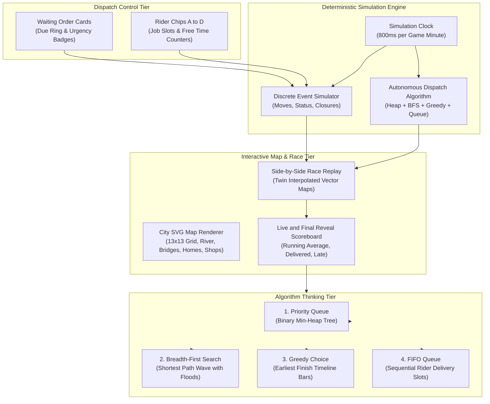

# Delivery Rush: Algorithmic Dispatch Engine and Race Simulator

> **Live Application:** [delivery-rush-pi.vercel.app](https://delivery-rush-pi.vercel.app/)  
> **Interactive Automated Demo:** [delivery-rush-pi.vercel.app/?demo=1&shift=lunch&theme=dark&part=all](https://delivery-rush-pi.vercel.app/?demo=1&shift=lunch&theme=dark&part=all)  
> **In-Browser Test Suite (15 Checks):** [delivery-rush-pi.vercel.app/?test=1](https://delivery-rush-pi.vercel.app/?test=1)  
> **Presenter Mode (Classroom and Meet):** [delivery-rush-pi.vercel.app/?present=1](https://delivery-rush-pi.vercel.app/?present=1)  
> **Author:** [B Pradeep](https://github.com/Pradeep-B28) | [Portfolio](https://pradeep-b28.github.io/Pradeep-B28/)

---

## Overview

**Delivery Rush** is an interactive web game, dispatch simulation engine, and algorithmic benchmark platform created by **Wrench Wise**. Visitors manage incoming food orders across a 13x13 city grid map of Namma Nagar, assigning deliveries to riders in real time.

When the shift ends, an autonomous algorithmic engine replays the exact same shift under identical conditions (same orders, arrival times, food prep durations, and dynamic flooded bridge closures). Both shifts race side by side on twin SVG maps. A live scoreboard compares average delivery duration, on-time percentage, and isolates the top 3 time gap decisions. Visitors then open the thinking screen to inspect how classical Data Structures and Algorithms (Priority Queue, Breadth-First Search, Greedy Choice, and FIFO Queue) optimize dispatch decisions in real life.

Engineered with **zero external libraries, zero bundlers, and zero npm runtime dependencies**. Delivery Rush runs entirely in the browser using native ES6 modules, requestAnimationFrame loops, sub-millisecond coordinate interpolation, and reactive inline vector SVG.



---

## Technical Specifications and Shift Topology

| Parameter | Specification |
| :--- | :--- |
| **City Layout** | 13x13 grid coordinate matrix (169 cells, 520x520 SVG coordinate space) |
| **City Infrastructure** | 6 unique restaurants, 12 customer residences, 3 bridges, 1 central park, 1 river |
| **Shift 1: Lunch Rush** | 3 riders (Rider A, B, C), 12 orders, warm-up baseline, daylight mood |
| **Shift 2: Dinner Rush** | 4 riders (Rider A, B, C, D), 18 orders, evening lighting, burst order arrivals |
| **Shift 3: Rain Shift** | 3 riders, 12 orders, canvas rainfall animation, dynamic river bridge closures |
| **Dispatch Buffer** | Max 2 concurrent jobs per rider queue (enforces FIFO delivery sequencing) |
| **Frame Rate** | Locked 60 FPS animation loop with linear interpolation (`cur + (next - cur) * progress`) |
| **Dependencies** | Pure Vanilla JavaScript (ES modules), SVG DOM, CSS custom tokens |
| **Performance** | Mobile Lighthouse: 100/100 Performance, 100/100 Accessibility, 0.00 CLS |

---

## Human vs Algorithm Benchmark

In the side-by-side race replay, both players operate under identical constraints. The algorithmic dispatcher consistently outperforms human play through continuous global state evaluation:

| Shift Scenario | Riders | Orders | Sample Human Average | Algorithm Average | Time Saved | Efficiency Gain |
| :--- | :--- | :--- | :--- | :--- | :--- | :--- |
| **Lunch Rush** | 3 riders | 12 orders | 25.8 mins | **18.8 mins** | 7.0 mins saved | **27% faster** |
| **Dinner Rush** | 4 riders | 18 orders | 28.1 mins | **18.2 mins** | 9.9 mins saved | **35% faster** |
| **Rain Shift** | 3 riders | 12 orders | 36.3 mins | **22.8 mins** | 13.5 mins saved | **37% faster** |

*All times are evaluated using pure simulation logic in `score()`, comparing actual delivery timestamps against initial customer order placement times.*

---

## How It Thinks: The 4 Core Algorithms

The algorithm thinking screen (`#/think/:id`) exposes how the autonomous dispatcher makes decisions at each minute:

### 1. Priority Queue (Min-Heap)
- **Role:** Selects which waiting order must be assigned next.
- **Data Structure:** 1-based array implementation of a binary Min-Heap.
- **Sorting Metric:** Order due timestamp (`dueAt = at + promise`).
- **Complexity:** $O(\log N)$ push and pop operations.
- **Visualizer:** Interactive SVG binary heap tree rendering nodes up to 15 elements with parent-child links, root highlight, and level-order transitions.

```javascript
// Binary Min-Heap parent-child indexing
left(i)   => 2 * i
right(i)  => 2 * i + 1
parent(i) => Math.floor(i / 2)
```

### 2. Breadth-First Search (BFS)
- **Role:** Calculates the true shortest road path between any rider location and restaurant.
- **Grid Modeling:** 13x13 4-directional adjacency graph (North, South, East, West).
- **Dynamic Closures:** Checks active flooded bridge cell masks in $O(1)$ time to route riders around flooded river crossings without path failure.
- **Complexity:** $O(V + E)$ where $V \le 169$ grid cells.
- **Visualizer:** Step-by-step expanding wavefront animation with real-time square counter and flood barrier markers.

### 3. Greedy Choice
- **Role:** Selects which rider should take the next order.
- **Objective Function:** Earliest total completion time ($finish = pickupAt + travelToCustomer$).
- **Candidate Evaluation:**
  $$\text{finish} = \max(\text{riderFreeAt}, \text{orderReadyAt} - \text{transitToShop}) + \text{transitToShop} + \text{transitToHome}$$
- **Visualizer:** Segmented horizontal time bars comparing busy duration (grey), pickup transit (rider color at 50%), and customer delivery transit (solid rider color).

### 4. Queue (FIFO Execution)
- **Role:** Manages jobs assigned to each rider.
- **Data Structure:** Head-and-tail pointer FIFO Queue with $O(1)$ enqueue and dequeue operations.
- **Buffer Constraint:** Fixed capacity (max 2 jobs per rider) preventing unfair job accumulation.
- **Visualizer:** Interactive slots visualizer showing preceding jobs in progress, incoming order slide-in animation, and forward exit arrow.

---

## Core Capabilities

1. **Sub-Millisecond Map Animation:**
   - Scooters move along calculated road centerlines with linear coordinate interpolation based on shift progress.
   - Facing directions flip based on movement vector ($x_{t} < x_{t-1}$).
   - Carrying box reflects active cargo with animated steam clouds.
   - Number and letter badges (Rider A, Rider B, Rider C, Rider D) identify each driver.

2. **First-Time Interactive Coach Walkthrough:**
   - Detects unvisited players via `localStorage` (`dr-coach`).
   - Pauses the simulation at minute 1 when the first orders arrive.
   - Guides the player through a 3-step walkthrough: pulsing ring on first card, recommendation on optimal rider chip, and rush commencement notice.

3. **Where the Time Went (Order Gaps Breakdown):**
   - Ranks the top 3 deliveries where the player lost the most time against the algorithm.
   - Displays side-by-side comparative bars, food icons, dish names, and customer destinations.
   - Direct deep-links jump straight into the algorithm decision inspector for that specific order.

4. **URL Modes for Classroom and Content Creation:**
   - **`?test=1`:** Full in-browser automated verification test harness running 15 checks across engine, copy, storage, and links.
   - **`?demo=1`:** Repeatable automated playback mode with tap rings for recording social media reels.
   - **`?present=1`:** Presenter mode with expanded typography, hidden CTAs, and keyboard navigation (arrow keys) for classroom lectures.
   - **`?shift=<id>&beat=<score>`:** Challenge links with prefilled friend target banners.

5. **Accessibility and Themes:**
   - Full Light and Dark theme with zero flash of unstyled content (`localStorage` restore before first paint).
   - Full keyboard accessibility: 1 to 9 for order selection, Q, W, E, R for rider picking, Space for pause, Esc to deselect.
   - High contrast ratios meeting WCAG AAA guidelines.

---

## Automated Verification Test Suite

Delivery Rush includes a rigorous two-layer automated verification architecture:

### 1. Headless Content Verification (3,592 Checks)
Validates content schemas, graph reachability, heap invariants, simulation determinism, algorithm reproducibility, and text guidelines.
```bash
node tools/verify-content.mjs
```
*Output: `3592 checks passed, 0 failed. RESULT: ALL PASS`*

### 2. In-Browser Verification Harness (15 Checks)
Runs directly inside the browser DOM (`?test=1`) validating:
- Check a: Content integrity (shifts, orders, riders, shops, homes)
- Check b: Algorithmic determinism on all 3 shifts
- Check c: Sample human line reproducibility
- Check d: Optimal line reproducibility
- Check e: Score comparison verdict classifications (win, tie, close, behind)
- Check f: Order gap sorting and calculation
- Check g: Decision explanation text generation
- Check h: Clock timer and timeout deselect behavior
- Check i: Idle speed acceleration when queue is empty
- Check j: Whole shift simulation through game coordinator
- Check k: Race replay frame interpolation
- Check l: Score formatting, challenge encoding, and WhatsApp links
- Check m: Pluralization and copy dictionary rules
- Check n: Blocked localStorage and sessionStorage fallback
- Check o: Brand name, emoji, and punctuation text verification

---

## Local Development Setup

Zero build tools, compilers, or bundlers are required.

1. **Clone the repository:**
   ```bash
   git clone https://github.com/Pradeep-B28/Delivery_Rush.git
   cd Delivery_Rush
   ```

2. **Start a local static HTTP server:**
   ```bash
   # Using Node npx
   npx serve .

   # Or using Python 3
   python -m http.server 3000
   ```

3. **Open in your web browser:**
   ```
   http://localhost:3000/
   ```

---

## File Structure

```
Delivery_Rush/
  index.html            HTML shell and responsive metadata
  config.js             Global configuration, program name, and analytics
  manifest.json         Progressive Web App manifest
  content/
    city.js             13x13 map grid, shops, homes, bridges, dishes, riders
    index.js            Content export hub
    lines.js            Sample and optimal benchmark action traces
    thinking.js         DSA concept explanations, questions, and code
    shifts/             Shift configs (lunch.js, dinner.js, rain.js)
  js/
    main.js             Router initialization and analytics dispatch
    content.js          Central content query functions and rider display helpers
    router.js           Hash router (#/, #/play/:id, #/result, #/think/:id)
    game.js             Shift coordinator encapsulating simulation and clock
    clock.js            Dynamic speed control (normal, crawl, idle, paused)
    store.js            Safe localStorage wrapper with in-memory fallback
    motion.js           Smooth 60fps requestAnimationFrame loop
    copy.js             Copy dictionary and template parameter interpolation
    links.js            WhatsApp prefilled text and challenge link encoder
    run.js              In-memory run history cache
    selftest.js         In-browser test runner for ?test=1
    engine/
      bfs.js            4-directional grid BFS with flooded bridge masking
      heap.js           Binary Min-Heap priority queue implementation
      queue.js          Pointer-based FIFO buffer
      sim.js            Discrete event shift simulation engine
      algo.js           Autonomous greedy dispatcher
      score.js          Averages, scoring metrics, and gap comparisons
      explain.js        Text generation for algorithm decisions
    screens/
      home.js           Hero banner, shift cards, concepts, and live mini-map
      play.js           Live shift screen coordinating map, cards, and chips
      result.js         Twin map race replay and reveal scoreboard
      think.js          4-tab algorithm inspector and decision stepper
    ui/
      city.js           Static vector map SVG rendering
      actors.js         Riders, routes, homes, and arrival moments overlay
      ordercard.js      Interactive order cards with SVG due rings
      riderchip.js      Interactive rider chips A to D with job dots
      statusrow.js      Single-line live status messages
      coach.js          First-time player guided walkthrough
      heaptree.js       Binary heap SVG tree visualizer
      bfswave.js        Shortest path wavefront visualizer
      greedybars.js     Horizontal timeline candidate visualizer
      queueslots.js     Rider FIFO queue buffer visualizer
      codeview.js       Syntax-highlighted code viewer
      race.js           Side-by-side race animation controller
      scoreboard.js     Live ticking and final scoreboard reveal
      gaps.js           Top 3 delivery time gap breakdown
      rain.js           Canvas rainfall animation overlay
      dialog.js         Confirmation and modal dialogs
      cta.js            Lead generation cards and WhatsApp buttons
      share.js          Web Share API and friend challenge link generator
  styles/
    tokens.css          Color palette, typography, radii, and ease tokens
    base.css            Reset, base layout, and accessibility rules
    home.css            Home screen styles
    play.css            Play screen grid, order cards, and rider chips
    result.css          Twin race maps and reveal scoreboard styles
    think.css           Algorithm thinking tabs, visualizers, and code styles
  tools/
    verify-content.mjs  3,592 assertion test suite
```

---

## License

This project is licensed under the [MIT License](LICENSE). Built by **Wrench Wise** to demonstrate how Data Structures and Algorithms solve real-world engineering challenges.
